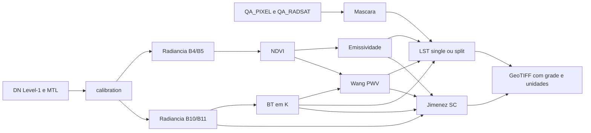

# Arquitetura e estrutura da v1.11

A biblioteca tem 12 algoritmos registrados, separados por familia. Calibracao,
leitura de imagens e validacao possuem funcoes proprias que nao sao entradas
adicionais do catalogo. RTE nao foi implementada; sua pasta permanece reservada.

## Pastas do projeto

| Pasta | Responsabilidade | Distribuicao |
|---|---|---|
| `pylstemp/` | Biblioteca e familias de algoritmos | Git, wheel e sdist |
| `docs/` | API, uso, arquitetura, referencias e validacao | Git e sdist |
| `exemples/` | Seis notebooks e script com imagens reais | Git e sdist |
| `scripts/` | Verificadores de cenas, modelos e referencias numericas | Git e sdist |
| `tests/` | Testes numericos, de API, IO e documentacao | Git e sdist |
| `.github/` | CI, publicacao, templates de issues e PR | Git |
| `Verificacao/` | Resultados e relatorios locais, historico e hashes | Ignorada pelo Git; fora dos pacotes |
| `dist/` | Wheel e sdist preparados localmente | Ignorada pelo Git; anexos de release opcionais |
| `.git/` | Historico e configuracao local do Git | Fora dos pacotes |

As imagens, artigos e versao anterior estao em pastas irmas, fora da v1.11.
`resultados/` e criada apenas ao executar exemplos e tambem e ignorada.
`build/`, `*.egg-info/`, caches e checkpoints sao intermediarios descartaveis.

## Arvore completa dos arquivos versionados

A arvore abaixo inclui todos os arquivos destinados ao repositorio nesta revisao.
Resultados locais e o conteudo de .git/ nao entram nela.

```text
.github/
  ISSUE_TEMPLATE/
    bug_report.md
    feature_request.md
  workflows/
    ci.yml
    publish.yml
  pull_request_template.md
docs/
  MELHORIAS_MODULOS_v1.11.md
  api-reference.md
  architecture.md
  comparacao_ndvi_v1.11.png
  du-pwv-workflow.md
  extending.md
  index.md
  installation.md
  publication.md
  references.md
  scientific-methods.md
  usage.md
  validation.md
exemples/
  DATA.md
  brightness.ipynb
  emissivity.ipynb
  fluxo_completo.py
  single_window.ipynb
  spectral_index.ipynb
  split_window.ipynb
  water_vapor.ipynb
pylstemp/
  algorithms/
    emissivity/
      __init__.py
      avdan_2016.py
      base.py
      gopinadh_2018.py
    radiative_transfer/
      __init__.py
    single_channel/
      __init__.py
      base.py
      jimenez_munoz_2014.py
      mono_window_2016.py
    spectral_index/
      __init__.py
      ndvi.py
    spectral_indices/
      __init__.py
      ndvi.py
    split_window/
      __init__.py
      base.py
      du_2015.py
      jimenez_munoz_2014.py
      kerr_1992.py
      price_1984.py
      sobrino_1993.py
    thermal/
      __init__.py
      brightness.py
    water_vapor/
      __init__.py
      wang_2015.py
    __init__.py
    base_temperature.py
  sensors/
    __init__.py
    landsat.py
  __init__.py
  api.py
  calibration.py
  exceptions.py
  messages.py
  metadata.py
  references.py
  registry.py
  requirements.py
  scene.py
  utils.py
  validation.py
  workflows.py
scripts/
  matrix_references.py
  validate_all_models.py
  validate_du_pwv.py
  validate_matrix_products.py
  validate_module_matrix.py
  validate_scenes.py
tests/
  conftest.py
  test_algorithms.py
  test_all_models.py
  test_api.py
  test_calibration_and_wang.py
  test_credits.py
  test_documentation.py
  test_domains.py
  test_du_pwv.py
  test_indices_messages_reflectance.py
  test_jimenez_single.py
  test_module_matrix.py
  test_radiance_workflow.py
  test_registry.py
  test_release_scope.py
  test_scene_io.py
  test_scientific_regressions.py
  test_validation.py
.gitattributes
.gitignore
CHANGELOG.md
CODE_OF_CONDUCT.md
CONTRIBUTING.md
CREDITS.md
LICENSE
MANIFEST.in
README.md
pyproject.toml
```

## Funcoes de calibration.py

| Funcao | Entrada e responsabilidade | Saida / acesso |
|---|---|---|
| `read_mtl` | Le campos escalares do MTL Landsat 8/9 | Metadados; exportada na raiz |
| `toa_radiance` | DN Level-1, ganho e offset por banda do MTL | Radiancia TOA W m-2 sr-1 um-1; raiz |
| `toa_reflectance` | DN optico Level-1, MTL e elevacao solar/SZA | Reflectancia TOA adimensional; raiz |
| `brightness` | Radiancia termica e K1/K2; DN apenas explicitamente | BT TOA em K; raiz e API |
| `brightness_from_mtl` | Atalho explicito DN -> radiancia -> BT com MTL | BT em K; acesso pelo modulo calibration |
| `quality_mask` | QA_PIXEL e QA_RADSAT; agua opcional | Mascara booleana True=invalido; pelo modulo |
| `surface_reflectance` | Escala DN de um produto SR Level-2 ja existente | SR adimensional; helper pelo modulo, fora do fluxo Level-1 |
| `normalize_thermal_band` | Normaliza aliases de B10/B11 | Nome canonico; helper pelo modulo |
| `_number` | Valida coeficiente numerico finito do MTL | Helper privado |
| `_level1` | Valida metadados Level-1 antes da calibracao DN | Helper privado |

`surface_reflectance` somente escala um SR ja corrigido: nao converte dados
Level-1 para SR e nao faz correcao atmosferica. Nenhum metodo LST atual exige
esse helper. Sua presenca e documentada sem modificar a compatibilidade.
A conversao Planck numerica compartilhada fica em utils.py.

## Catalogo de algoritmos

| Familia | Arquivo | Chave |
|---|---|---|
| spectral_index | `ndvi.py` | `ndvi` |
| thermal | `brightness.py` | `brightness` |
| emissivity | `avdan_2016.py` | `avdan-2016` |
| emissivity | `gopinadh_2018.py` | `gopinadh-2018` |
| single_channel | `mono_window_2016.py` | `mono-window-2016` |
| single_channel | `jimenez_munoz_2014.py` | `jimenez-munoz-sc-2014` |
| split_window | `du_2015.py` | `du-2015` |
| split_window | `jimenez_munoz_2014.py` | `jimenez-munoz-2014` |
| split_window | `kerr_1992.py` | `kerr-1992` |
| split_window | `price_1984.py` | `price-1984` |
| split_window | `sobrino_1993.py` | `sobrino-1993` |
| water_vapor | `wang_2015.py` | `wang-2015` |
| radiative_transfer | `__init__.py` | Sem algoritmo; familia reservada |

Os arquivos sao relativos a `pylstemp/algorithms/<familia>/`.
`spectral_indices/` e um namespace de compatibilidade ligado ao mesmo NDVI;
nao e uma segunda implementacao ou uma segunda entrada no catalogo.
O registro thermal preserva helpers antigos que recebem DN. A funcao publica
canonica brightness esta em calibration.py e recebe radiancia por padrao.
`single_channel/base.py`, `split_window/base.py` e `emissivity/base.py`
compartilham validacao; nao sao algoritmos adicionais.

## Leitura, orquestracao e infraestrutura

- `scene.py`: LandsatScene abre uma cena alinhada, le recortes com read(),
  calibra com calibrated(), exporta com write_geotiff() e fecha com close().
  Usa rasterio ou Pillow. B2 e opcional; B4/B5/B10/B11 e QA sao necessarias.
- `api.py`: valida entradas, seleciona os metodos e calcula NDVI/emissividade
  nos fluxos LST. Inclui helpers emissivity_band_10/11. brightness e reexportada
  de calibration; nao existe uma segunda formula publica de BT.
- `__init__.py`: exports da raiz e versao. Acesso direto aos helpers de
  calibration e LandsatScene e feito pelos respectivos modulos.
- `sensors/landsat.py`: constantes e validacao de sensor Landsat 8/9.
  Para imagens reais, o MTL correspondente fornece os coeficientes de calibracao.
- `registry.py` e `metadata.py`: descoberta e metadados AlgorithmSpec/AlgorithmMetadata.
- `algorithms/__init__.py`: descobre familias e evita duplicar aliases legados.
- `validation.py` e `utils.py`: formas, unidades, mascaras e calculos compartilhados.
- `messages.py`, `requirements.py` e `exceptions.py`: erros contextualizados,
  requisitos por metodo e classes de excecao.
- `references.py`: creditos da biblioteca original; detalhes cientificos em docs/references.md.

## Fluxo das grandezas



PWV e requerido por Jimenez SC/SW; Du o aceita como escalar ou raster opcional.
O fluxo Avdan utiliza BT e emissividade. A alternativa reflectancia TOA deve
ser explicitamente selecionada. Consulte os [contratos cientificos](scientific-methods.md).

## Scripts e processos de publicacao

validate_scenes.py verifica cenas; validate_all_models.py verifica modelos e
recortes; validate_module_matrix.py cruza modulos e metodos; matrix_references.py
fornece referencias independentes. validate_matrix_products.py compara arquivos
com uma rodada historica, portanto depende de resultados locais existentes; --baseline permite indicar
a rodada de referencia em qualquer pasta.
A leitura de pastas de dados e informada por argumentos; dados nao sao fornecidos
nos pacotes. Scripts com PWV usam halo e extremos globais de NDVI.

A CI executa testes e build em Linux/Windows para Python 3.9/3.11/3.14.
O workflow publish.yml, acionado por release publicada, confere a versao da tag,
executa testes, constroi os pacotes e valida-os antes de enviar ao PyPI.
Veja [preparacao para publicacao](publication.md).

A camada `pylstemp/workflows.py` oferece `du_from_scene`, `scene_ndvi_range` e
`DuSceneResult`, com modos explicitos e exportacao rastreavel. Veja
[workflow Du/PWV](du-pwv-workflow.md).
