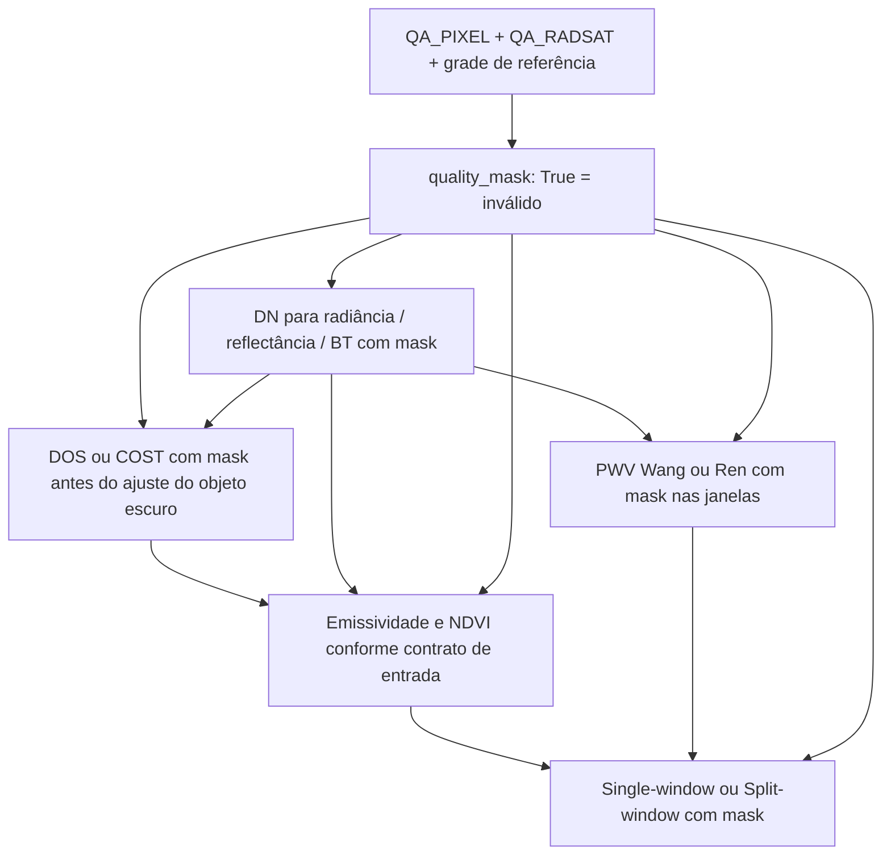

# Bandas QA: entradas e ponto de aplicação

QA_PIXEL e QA_RADSAT são GeoTIFFs de qualidade da mesma cena Landsat 8/9 Collection 2. Elas são entradas do preparo da máscara; seus valores são códigos de bits, não radiância nem reflectância.

## 1. Entradas explícitas por arquivo

```python
from pylstemp import quality_mask

mascara = quality_mask(
    qa_pixel_path="cena_QA_PIXEL.TIF",
    qa_radsat_path="cena_QA_RADSAT.TIF",
    reference_path="vermelho_calibrado.tif",
    exclude_water=False,
)
```

Os três argumentos são obrigatórios na assinatura. A função requer rasterio, instalado com `pip install -e ".[examples]"`. Ela recusa caminhos ausentes, QA multibanda ou não inteira e dimensões, CRS ou transformação diferentes da referência. Nodata das QA também torna o pixel inválido. Ela não comprova identidade temporal pelo nome: cabe ao usuário selecionar arquivos da mesma cena. Para recortes, recorte ambas as QA na mesma janela; não reprojete silenciosamente nem use interpolação contínua.

A imagem de referência define a grade; seus valores e nodata não são lidos por essa função. Ao carregar as entradas físicas, combine seus valores inválidos com a máscara QA:

```python
import numpy as np
mascara |= ~np.isfinite(red) | ~np.isfinite(nir)
```

Os 16 notebooks de metodos/calibracao incluem os caminhos das QA na primeira célula de código, a chamada acima na segunda e o uso de `mask=mascara` na terceira. Nenhum exemplo substitui QA ausente por zeros ou por uma máscara vazia.

## 2. Fluxo em cada etapa



Cada seta de dados depende do método: as correções DOS/COST produzem reflectância corrigida e não substituem radiância quando o método exige radiância. A máscara não muda unidades, contratos ou equações. Reutilize a máscara base e acrescente nodata de cada entrada. Nos estimadores locais de PWV, aplique-a antes de compor as janelas; em DOS/COST, antes de calcular percentis e ajustar os parâmetros. Não basta mascarar apenas o mapa final, pois os pixels contaminados já teriam influenciado os cálculos.

| Função | Entrada QA na chamada |
| --- | --- |
| `toa_radiance`, `toa_reflectance`, `brightness` | `mask=mascara` antes da calibração |
| `optical_correction` (DOS/COST) | `mask=mascara` antes de ajustar parâmetros; ao reutilizar parâmetros, continue mascarando os pixels |
| `emissivity` | `mask=mascara` antes do NDVI interno e da emissividade |
| `water_vapor` (Wang/Ren) | `mask=mascara` antes das janelas/estatísticas locais |
| `single_window`, `split_window` | `mask=mascara`, incluindo também inválidos das BT, emissividades e PWV fornecidos |

Não forneça o GeoTIFF QA ao argumento `mask=`: ele recebe uma matriz **booleana**, com True para exclusão. As funções numéricas não procuram QA automaticamente, nem conseguem comprovar que uma matriz previamente calculada recebeu QA. Chamadas com `mask=None` continuam disponíveis para matrizes preparadas e usos numéricos, sem garantia de controle QA.

## 3. Rota por pasta de cena

```python
from pylstemp.scene import LandsatScene

with LandsatScene("pasta_da_cena") as cena:
    bandas, bt, mascara = cena.calibrated()
    # QA já aplicada à calibração; passar mascara aos métodos seguintes.
    # Alternativa para leitura manual:
    mascara_manual = cena.quality_mask(exclude_water=False)
```

O construtor exige os arquivos originais B4, B5, B10, B11, QA_PIXEL, QA_RADSAT e MTL; verifica a grade. B2 e SZA são opcionais. `calibrated()` chama `quality_mask()` da cena antes de calibrar. Não é necessário informar os caminhos QA outra vez nessa rota.

## 4. Política de seleção implementada

- QA_PIXEL: preenchimento, nuvem dilatada, cirrus, nuvem, sombra e neve (bits 0 a 5).
- QA_RADSAT: saturação óptica B2/B4/B5 e oclusão de terreno (bits 1, 3, 4 e 11). É uma política conservadora comum ao fluxo atual; não identifica saturação térmica nem garante seleção de saturação de outras bandas ópticas.
- Água: preservada por padrão. `exclude_water=True` acrescenta o bit 7 de QA_PIXEL; o notebook terrestre de Wang adota essa opção explicitamente.


QA seleciona a qualidade das observações de entrada. As flags diagnósticas da biblioteca descrevem outras condições dos estimadores (domínios, extrapolações etc.). Uma não substitui a outra. Essa alteração não reprocessa nem modifica as rodadas históricas do artigo.

## Nome publico

Importe `quality_mask` de `pylstemp`. A funcao recebe caminhos de arquivos,
com ambas as QA e `reference_path` obrigatorios. O nome anterior
`read_quality_mask` foi retirado, sem alias de compatibilidade.
A decodificacao de matrizes e interna; `LandsatScene.quality_mask()` continua
oferecendo a mascara da cena com o mesmo comportamento.

## Exemplo dedicado

Execute [quality_mask.ipynb](../exemple/quality_mask.ipynb) para conferir
QA, nodata, exclusao opcional de agua e exportacao da mascara combinada.
