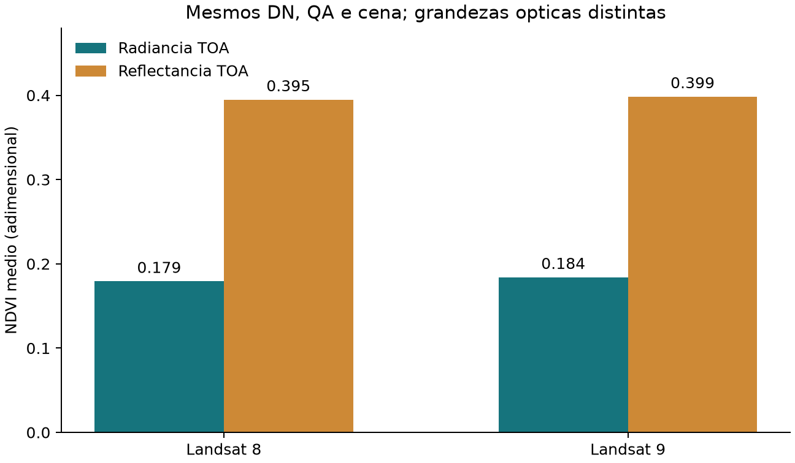

# Validacao atual - v1.11.0

## Du/PWV - verificacao de 22/10/2026

O suporte PWV raster em Du e o [workflow Wang -> Du](du-pwv-workflow.md)
foram verificados. A estimativa atmosferica original Du/Ren permanece pendente
de auditoria das equacoes; as comparacoes com esse estimador nao foram executadas.

A suite passou **759 testes e 106 subtestes**, com um warning esperado de
adaptacao Price/AVHRR. Cobertura: 94.06% das linhas e 85.51% dos branches.
A base anterior passou 716 testes e 108 subtestes; duas expectativas antigas de
rejeicao de arrays foram substituidas pelo contrato raster.
O ambiente local foi Windows com Python 3.14.7. Outros interpretadores e sistemas
operacionais dependem da matriz da CI.

Foram conferidos limites e sobreposicoes com referencia independente, mascara,
PWV invalido, ausencia de broadcasting e preservacao das entradas. Raster
constante coincide exatamente com escalar. O workflow raster reproduziu a
execucao inteira em quatro blocos com halo e limites globais de NDVI fixos,
inclusive com chunk_rows=1 e chunk_rows=8.

### Cenas reais e suporte valido

Dois recortes centrais de 128 x 128 pixels, com halo de 10 pixels para Wang,
calibracao pelo MTL correspondente, radiancia TOA e emissividade Gopinadh.
Os extremos NDVI foram recalculados sobre cada cena completa, por faixas;
a execucao LST/PWV desta rodada cobriu os recortes.

| Cena | Du geral: validos | PWV medio: validos | PWV raster: validos | Suporte comum |
|---|---:|---:|---:|---:|
| Landsat 8, 2026-09-19 | 16384 | 16384 | 15056 | 15056 |
| Landsat 9, 2026-09-27 | 16384 | 16384 | 14495 | 14495 |

PWV medio aceito: 3.3059518979 g/cm2 (Landsat 8) e 3.4535365221 g/cm2
(Landsat 9). Respectivamente, zero e 28 pixels tiveram PWV bruto finito fora
do dominio comum [0.066,6.3]. Lacunas locais de regressao foram preservadas
no modo raster. O modo media aplica um escalar aos pixels com entradas validas.

| Diferenca media de LST no suporte comum, K | Landsat 8 | Landsat 9 |
|---|---:|---:|
| Geral menos PWV medio | 0.4930096492 | 0.2530898488 |
| Geral menos PWV raster | 0.5131135320 | 0.2518587248 |
| PWV medio menos raster | 0.0201038827 | -0.0012311240 |

Erro maximo de LST frente a equacao independente: 1.71e-13 K
(tolerancia 2e-10 K). Seis amostras de PWV foram comparadas com referencia
escalar independente, com tolerancia 1e-8 g/cm2, incluindo verificacao de NaN.
Foram reabertos e conferidos **24 GeoTIFFs**: float32, NoData NaN, grade,
CRS, unidades e valores. Wheel/sdist passaram no build e em `twine check`;
o wheel instalado separadamente passou no teste de importacao e Du raster.

Esses resultados verificam implementacao e funcionamento, sem medir acuracia
absoluta. A transferencia dos coeficientes para Landsat 9 continua experimental.

### Reproduzir

Na raiz do repositorio, com as dependencias de desenvolvimento e exemplos:

```bash
python -m pytest --cov=pylstemp --cov-branch
python scripts/validate_du_pwv.py --input CAMINHO_DAS_CENAS --output resultados/validacao_du
python -m build
python -m twine check dist/*
```

A pasta de saida do validador deve ser nova. As cenas devem estar em subpastas
com seus respectivos arquivos Level-1 e MTL. Logs, hashes, rasters e o relatorio
detalhado ficam no arquivo local `Verificacao/`, excluido do repositorio e dos
pacotes. As verificacoes abaixo documentam rodadas anteriores.

## Escopo

O catalogo tem 12 algoritmos, incluindo Jimenez-Munoz single-channel e
split-window com nomes distintos. NDVI e o unico indice; emissividade usa
Avdan e Gopinadh. O fluxo padrao usa radiancia TOA, BT em K e QA.
TOA reflectance e uma alternativa explicita; EVI, Xiaolei e reflectance()
nao fazem parte do escopo atual.

## Novo Jimenez single-channel

Foram conferidas visualmente as Eqs. 1, 2, 4 e 6 no artigo original.
O metodo usa radiancia/BT da B10, emissividade e PWV. A restricao operacional
[0,3] g/cm2 decorre da perda de precisao do ajuste polinomial acima de 3
relatada pelo artigo. Escalares invalidos geram erro; pixels raster fora do
intervalo ou invalidos produzem NaN. A restricao nao garante acuracia.

A nova matriz em recortes centrais das duas cenas registrou 24 casos aprovados
(duas emissividades, duas unidades e tres modos de PWV) e 16 rejeicoes
esperadas, sem falhas inesperadas. Os 24 GeoTIFFs foram conferidos.
PWV escalar de 1/2 g/cm2 foi usado como entrada controlada, nao como observacao
meteorologica. O terceiro modo utilizou o raster calculado por Wang.
Resultados comparados com uma referencia algebrica independente, tolerancia
absoluta 2e-10 K. Landsat 9 continua sendo transferencia experimental.

## Software e exemplos

Passaram 716 testes e 108 subtestes; cobertura de linhas: 94.03%.
README, guia, script e seis notebooks foram executados nas duas cenas reais:
18 execucoes e 68 exportacoes GeoTIFF verificadas, sem falhas inesperadas.
As verificacoes incluem tipo float32, NoData NaN, coordenadas, unidades e
pixels finitos. O script oferece dez produtos; o guia inclui reflectancia
opcional. Nao ha bandas sinteticas nem imports NumPy nos exemplos de uso.

Evidencias da rodada:
`Verificacao/v1.11.0/jimenez_single_documentacao_2026-10-05/`.

## Evidencia anterior dos modelos existentes

A rodada em radiancia anterior percorreu 116.381.412 pixels nas duas cenas.
Metodos sem PWV foram executados nas cenas completas; Wang e Jimenez SW
foram avaliados em tres recortes por cena, com halo e extremos globais de NDVI.
A matriz anterior, com 11 algoritmos, registrou 498 casos: 294 aprovados e
204 rejeicoes esperadas, sem falhas inesperadas. Foram conferidos 120 GeoTIFFs.
Essa matriz foi preservada; nao foi reexecutada integralmente nesta adicao.

| Cena | NDVI medio em radiancia | NDVI medio em reflectancia TOA |
|---|---:|---:|
| Landsat 8 | 0.179375 | 0.394940 |
| Landsat 9 | 0.184130 | 0.398547 |



Nao ha observacoes independentes de LST/PWV para medir acuracia. Os limiares
de emissividade, transferencia de sensores e adaptacoes AVHRR requerem
avaliacao cientifica propria. Veja [contratos cientificos](scientific-methods.md).
